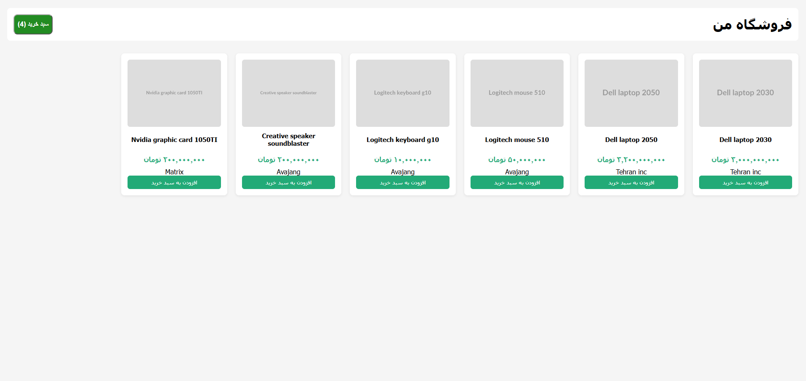
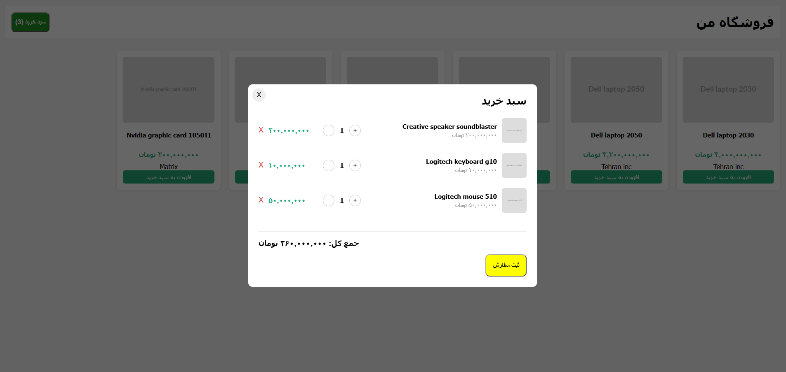

# Online-shop ,  فروشگاه اینترنتی

A small RTL e-commerce frontend built with vanilla HTML, CSS, and JavaScript.

Live demo: https://kourosh89-prog.github.io/online-shop/

[](https://kourosh89-prog.github.io/online-shop/)

## Features

- Introducing products at home webpage with grid rendered from data
- Product detail modal with specs
- Checkout flow with order confirmation
- Add to cart with localStorage persistence
- Cart view with quantity controls, remove, and live total
- Fully RTL (Persian) layout



## Tech

- HTML5
- CSS3 (Grid + Flexbox)
- Vanilla JavaScript 
- localStorage for cart persistence

## How to run

1. Clone the repo:
   ```bash
   git clone https://github.com/Kourosh89-prog/online-shop.git
2. Open `index.html` in a browser — or use Live Server in VS Code.

## What I learned 

- Rendering UI from data with `.map().join("")` — the same pattern React uses
- Event delegation to handle clicks on dynamically created elements
- Managing state with `localStorage` and keeping the DOM in sync
- Modal and panel patterns with CSS class toggling
- RTL layouts and Persian number formatting with `toLocaleString("fa-IR")`
- Flexbox and Grid for responsive product cards and cart rows

## Possible improvements

- Migrate to React
- Add a backend (Node + Express or Python + FastAPI)
- Real database (SQLite, Postgres)
- Real payment gateway (Zarinpal / IDPay)
- Search and category filter
- Stock limit enforcement

